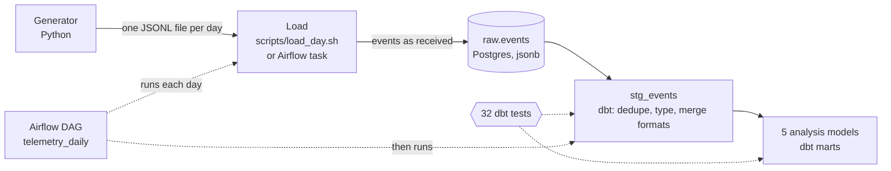

# Game telemetry pipeline

A small data pipeline for game telemetry (PC and console), built end to end on a laptop:
a Python event generator, raw storage in Postgres, and cleaning and analysis models in dbt, with automated tests.

The data is **synthetic**. The generator produces about 1.1 million events for 100,000 players over 30 days, and it injects the kind of mess real telemetry has: duplicate events, late events, missing fields, and an app update that renamed fields halfway through.

## What it answers

| Model | Question |
|---|---|
| `daily_active_players` | How many players started a session each day? |
| `milestone_funnel` | How many players reach each milestone, from the tutorial to the credits? |
| `sessions` | What does each play session look like (length, number of events, how it ended)? |
| `retention` | What share of each signup cohort comes back on day 1 and day 7? |
| `app_version_health` | How do crash rate and session length compare between app versions? |

## Pipeline



1. **Generate.** `generator/generate_events.py` writes one JSONL file per day of arrival. The same seed always gives the same files.
2. **Load.** `scripts/load_raw.sh` loads every file as-is into `raw.events`, one `jsonb` value per event, one day at a time. Each row keeps the name of its source file, so a day can be reloaded without creating duplicates.
3. **Clean.** The `stg_events` model keeps one row per `event_id` (the first received copy), converts types, and merges the two app formats into one set of columns (`milestone` and `milestone_id`, seconds and milliseconds).
4. **Analyse.** Five models build the tables above from `stg_events`.
5. **Test.** 32 dbt tests check uniqueness, missing values, accepted values, relationships between tables, and that no session ends before it starts.

## Design decisions

- **Keep the raw data untouched.** Events are stored as received, one `jsonb` value each. Cleaning happens in dbt, so a wrong rule can be fixed and replayed without reloading anything.
- **Deduplicate with `ROW_NUMBER`.** For each `event_id`, the first received copy is kept. This is plain standard SQL, which keeps the models portable to another engine.
- **Everything in UTC.** Timestamps are stored and compared in UTC. Local time zones are a display concern, not a storage one.
- **Two app formats, one set of columns.** An update renamed fields halfway through the 30 days. The staging model merges both formats (`milestone` and `milestone_id`, seconds and milliseconds), so the analysis models never see the difference.
- **Late events are kept.** Both `event_time` (when it happened) and `received_at` (when it arrived) are stored, so lateness can be measured instead of hidden.
- **Idempotent loading.** Each row remembers its source file. Loading a day deletes that file's rows and reinserts them in one transaction, so a retry never duplicates data.
- **Tests as contracts.** Uniqueness, missing values, accepted values, relationships, and "no session ends before it starts" are tested on every `dbt build`.

## Results on the generated data

- 1,108,524 raw events become 1,097,789 clean events. The 10,735 removed rows are exactly the duplicates.
- 33,523 events (about 3 percent) arrived more than an hour late. They are kept, with both `event_time` and `received_at`.
- 358,489 sessions. About 3 percent end in a crash, with almost the same rate on both app versions (2.97 and 3.05 percent).
- Retention is about 40 percent on day 1 and about 20 percent on day 7.
- Only 5 percent of registered players reach the credits.

## Run it

You need Docker, Python 3.14 and Git. The commands run from the repository root.

```bash
# 1. Database password (any value you like), then start Postgres 17
echo "POSTGRES_PASSWORD=choose-a-password" > .env
docker compose up -d

# 2. Create the schemas and the raw table
docker compose exec -T postgres psql -U telemetry -d telemetry < sql/00_setup.sql

# 3. Python environment and generated data (about 1.1 million events)
python -m venv .venv
source .venv/bin/activate
pip install -r requirements.txt
python generator/generate_events.py --seed 42

# 4. Load the raw events
bash scripts/load_raw.sh

# 5. Build the models and run the tests
set -a; source .env; set +a
cd dbt
dbt build
```

`dbt build` creates the models in the schemas `dbt_staging` and `dbt_marts`, then runs the 32 tests.

## Daily run with Airflow

The DAG `telemetry_daily` (`dags/telemetry_daily.py`) plays one simulated day per run: it loads that day's file into `raw.events`, then runs `dbt build` (models and tests).

- It catches up three days in a row (1 to 3 October 2026), one at a time.
- Loading a day replaces its rows instead of adding to them, so a run can be repeated safely: after replaying one day, `raw.events` kept exactly the same number of rows.
- If the load fails, it is retried once. If it fails again, `dbt_build` does not start. After fixing the cause, clearing only the failed task resumes the chain.
- Limits: the days are simulated (the files are generated up front), and dbt rebuilds every table on each run instead of processing only new data.

```bash
# Once: your user id for Airflow, and its metadata database
echo "AIRFLOW_UID=$(id -u)" >> .env
docker compose exec -T postgres psql -U telemetry -d telemetry -c "CREATE DATABASE airflow"

# Build the image, initialise, start
docker compose -f compose.yaml -f compose.airflow.yaml build
docker compose -f compose.yaml -f compose.airflow.yaml up airflow-init
docker compose -f compose.yaml -f compose.airflow.yaml up -d
```

Open http://localhost:8080 (user `airflow`, password `airflow`, reachable from your machine only), then switch the DAG on. The data must be generated first (steps 1 to 3 above).

## Repository layout

| Path | Content |
|---|---|
| `generator/` | The event generator |
| `docs/events.md` | Event schema, milestones, and the deliberate data quality problems |
| `scripts/` | `load_raw.sh` loads all days, `load_day.sh` loads one day (safe to repeat) |
| `dags/` | The Airflow DAG that runs the pipeline daily |
| `sql/` | First version of the pipeline as plain SQL files (see below) |
| `dbt/` | The dbt project: sources, models, tests |
| `compose.yaml` | Postgres 17 |
| `compose.airflow.yaml`, `Dockerfile.airflow` | Airflow 3.4 with dbt, added on top of `compose.yaml` |

The `sql/` folder is the first, hand-run version of the pipeline. The dbt models reproduce its tables exactly: each dbt table was compared row by row with its plain SQL twin, with no difference. `sql/10_quality_checks.sql` prints the row counts before and after cleaning.

## Stack

Python, PostgreSQL 17, Docker Compose, dbt Core 1.12 with the Postgres adapter, Apache Airflow 3.4.

## Next

A run of the same models on Snowflake.
